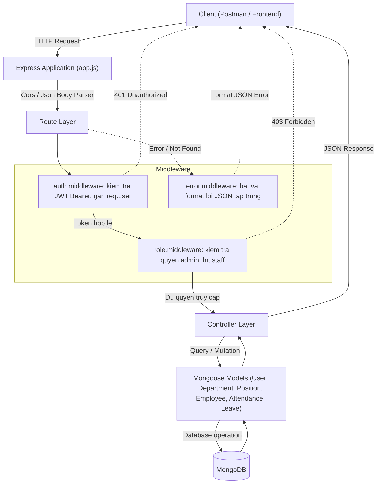

# HR Management API - Bai 1 va Bai 2

He thong REST API quan ly nhan su gom xac thuc JWT, phan quyen vai tro (admin, hr, staff), quan ly phong ban, chuc vu, ho so nhan vien, cham cong va nghi phep.

---

## 1. Luong Xu Ly Du Lieu (Data Flow)



---

## 2. Danh Sach API Endpoints

### 2.1. Authentication (/api/auth)

| Method | Endpoint | Mo ta | Quyen |
|---|---|---|---|
| POST | /api/auth/register | Dang ky tai khoan | Public |
| POST | /api/auth/login | Dang nhap va nhan JWT token | Public |
| GET | /api/auth/me | Thong tin user hien tai | User da dang nhap |

### 2.2. Phong Ban (/api/departments)

| Method | Endpoint | Mo ta | Quyen |
|---|---|---|---|
| GET | /api/departments | Danh sach phong ban | admin, hr, staff |
| GET | /api/departments/:id | Chi tiet phong ban | admin, hr, staff |
| POST | /api/departments | Them phong ban | admin, hr |
| PUT | /api/departments/:id | Cap nhat phong ban | admin, hr |
| DELETE | /api/departments/:id | Xoa mem phong ban (chan neu con nhan vien) | admin |

### 2.3. Chuc Vu (/api/positions)

| Method | Endpoint | Mo ta | Quyen |
|---|---|---|---|
| GET | /api/positions | Danh sach chuc vu | admin, hr, staff |
| GET | /api/positions/:id | Chi tiet chuc vu | admin, hr, staff |
| POST | /api/positions | Them chuc vu | admin, hr |
| PUT | /api/positions/:id | Cap nhat chuc vu | admin, hr |
| DELETE | /api/positions/:id | Xoa mem chuc vu (chan neu con nhan vien) | admin |

### 2.4. Nhan Vien (/api/employees)

| Method | Endpoint | Mo ta | Quyen |
|---|---|---|---|
| GET | /api/employees | Danh sach nhan vien (loc, tim kiem, phan trang, sort, populate) | admin, hr, staff |
| GET | /api/employees/:id | Chi tiet nhan vien (kem phong ban, chuc vu, quan ly) | admin, hr, staff |
| POST | /api/employees | Them nhan vien moi | admin, hr |
| PUT | /api/employees/:id | Cap nhat nhan vien | admin, hr |
| DELETE | /api/employees/:id | Xoa mem nhan vien | admin |

### 2.5. Cham Cong (/api/attendances)

| Method | Endpoint | Mo ta | Quyen |
|---|---|---|---|
| POST | /api/attendances/check-in | Check-in theo ngay | admin, hr, staff |
| POST | /api/attendances/check-out | Check-out va tinh gio lam | admin, hr, staff |
| GET | /api/attendances | Danh sach cham cong tat ca nhan vien | admin, hr |
| GET | /api/attendances/me | Lich su cham cong ca nhan | admin, hr, staff |
| GET | /api/attendances/employee/:employeeId | Cham cong theo nhan vien | admin, hr |

### 2.6. Nghi Phep (/api/leaves)

| Method | Endpoint | Mo ta | Quyen |
|---|---|---|---|
| POST | /api/leaves | Gui don nghi phep moi | admin, hr, staff |
| GET | /api/leaves | Danh sach tat ca don nghi phep | admin, hr |
| GET | /api/leaves/me | Danh sach don nghi cua ban than | admin, hr, staff |
| GET | /api/leaves/:id | Chi tiet don nghi phep | admin, hr, staff |
| PATCH | /api/leaves/:id/approve | Duyet don nghi phep | admin, hr |
| PATCH | /api/leaves/:id/reject | Tu choi don nghi phep | admin, hr |

---

## 3. Huong Dan Cai Dat va Chay

```bash
npm install
npm run dev
npm test
```
