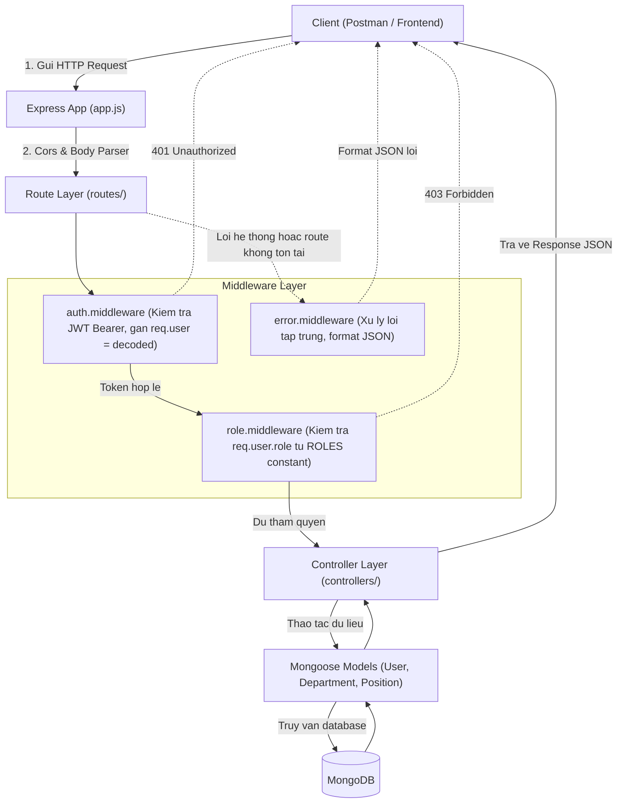
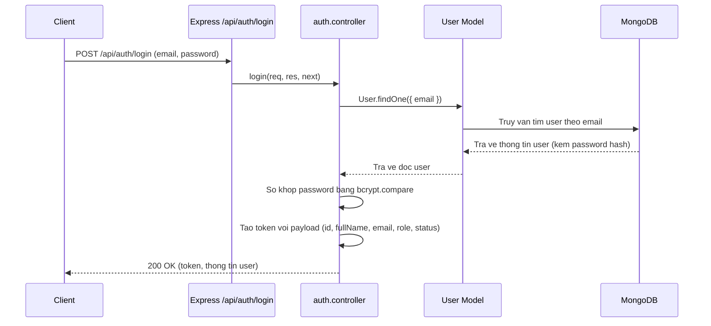
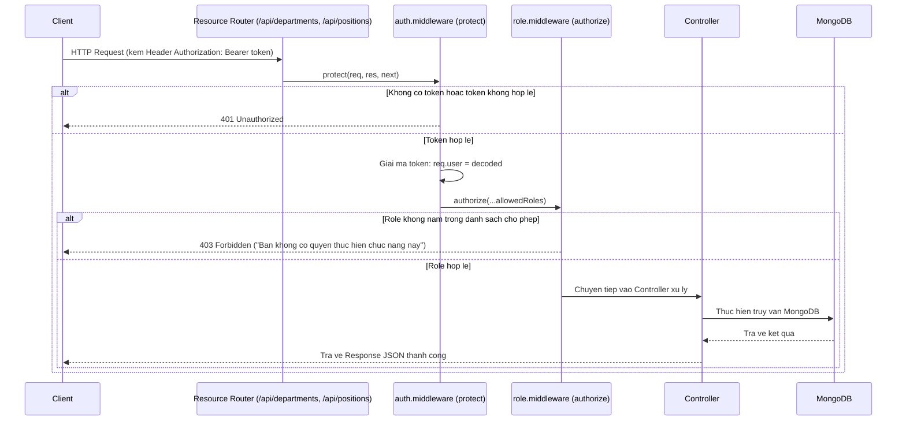

# HR Management API - Bai 1: Authentication & Quan Ly Danh Muc Nhan Su

He thong backend xay dung bang Node.js, ExpressJS, MongoDB va Mongoose cung cap cac tinh nang xac thuc JWT, phan quyen nguoi dung theo vai tro va quan ly danh muc phong ban, chuc vu.

---

## 1. Luong Du Lieu (Data Flow)

### 1.1. So do kien truc tong the



---

### 1.2. Luong Dang Nhap va Cap JWT Token



---

### 1.3. Luong Phan Quyen Truy Cap API (Protected Routes)



---

## 2. Cau Truc Thu Muc

```txt
08-09-2026/
├── src/
│   ├── config/
│   │   └── db.js
│   ├── controllers/
│   │   ├── auth.controller.js
│   │   ├── department.controller.js
│   │   └── position.controller.js
│   ├── middlewares/
│   │   ├── auth.middleware.js
│   │   ├── error.middleware.js
│   │   └── role.middleware.js
│   ├── models/
│   │   ├── Department.js
│   │   ├── Position.js
│   │   └── User.js
│   ├── routes/
│   │   ├── auth.routes.js
│   │   ├── department.routes.js
│   │   └── position.routes.js
│   ├── utils/
│   │   ├── constant.js
│   │   └── generateToken.js
│   ├── app.js
│   ├── constant.js
│   └── server.js
├── .env.example
├── .gitignore
├── package.json
├── README.md
└── test-api.js
```

---

## 3. He Thong Hang So (constant.js)

Toan bo cac gia tri co dinh ve vai tro va trang thai deu duoc dong goi tai `src/utils/constant.js` va tai su dung xuyen suot he thong (Models, Controllers, Routes):

```javascript
const ROLES = {
  ADMIN: "admin",
  HR: "hr",
  STAFF: "staff"
};

const STATUS = {
  ACTIVE: "active",
  INACTIVE: "inactive"
};
```

---

## 4. Danh Sach API Endpoints

### 4.1. Authentication

| Method | Endpoint | Mo ta | Quyen truy cap |
|---|---|---|---|
| POST | `/api/auth/register` | Dang ky tai khoan moi | Public |
| POST | `/api/auth/login` | Dang nhap lay token | Public |
| GET | `/api/auth/me` | Lay thong tin user hien tai | User da dang nhap |

### 4.2. Quan Ly Phong Ban (Departments)

| Method | Endpoint | Mo ta | Quyen truy cap |
|---|---|---|---|
| GET | `/api/departments` | Danh sach phong ban | admin, hr, staff |
| GET | `/api/departments/:id` | Chi tiet phong ban | admin, hr, staff |
| POST | `/api/departments` | Them phong ban moi | admin, hr |
| PUT | `/api/departments/:id` | Cap nhat phong ban | admin, hr |
| DELETE | `/api/departments/:id` | Xoa mem phong ban (status: inactive) | admin |

### 4.3. Quan Ly Chuc Vu (Positions)

| Method | Endpoint | Mo ta | Quyen truy cap |
|---|---|---|---|
| GET | `/api/positions` | Danh sach chuc vu | admin, hr, staff |
| GET | `/api/positions/:id` | Chi tiet chuc vu | admin, hr, staff |
| POST | `/api/positions` | Them chuc vu moi | admin, hr |
| PUT | `/api/positions/:id` | Cap nhat chuc vu | admin, hr |
| DELETE | `/api/positions/:id` | Xoa mem chuc vu (status: inactive) | admin |

---

## 5. Huong Dan Cai Dat Va Khoi Chay

### 5.1. Cai dat dependencies

```bash
npm install
```

### 5.2. Cau hinh moi truong

Tao file `.env` tu `.env.example`:

```env
PORT=5000
MONGO_URI=mongodb://localhost:27017/hr_management
JWT_SECRET=your_jwt_secret
JWT_EXPIRES_IN=7d
```

### 5.3. Chay ung dung

Chay che do phat trien (nodemon):

```bash
npm run dev
```

Chay che do production:

```bash
npm start
```

Chay kiem thu tu dong:

```bash
npm test
```
