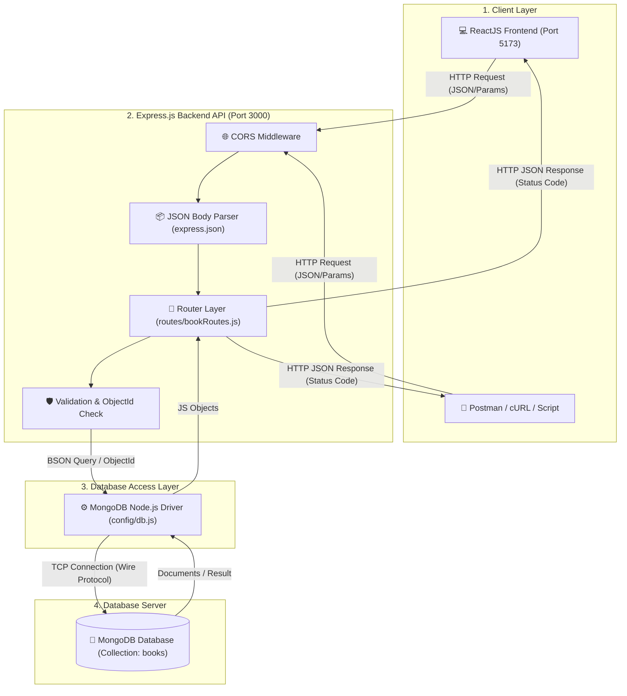
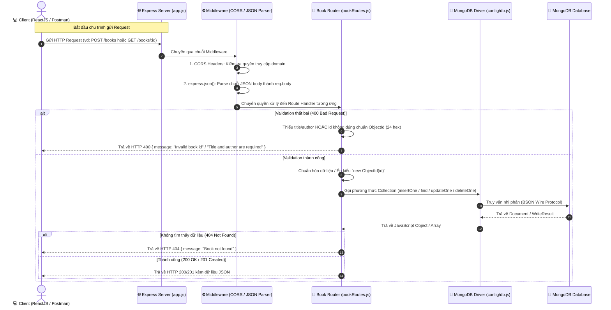

# 📚 Buổi 08: Tích Hợp MongoDB Với Express Và Xây Dựng CRUD API Cho Thư Viện Sách (Library)

> **Môn học:** Lập trình NodeJS (Aptech Sem 3 - Lớp C2411L)  
> **Ngày học:** 27/08/2026  
> **Giảng viên:** Lê Văn Nhật Quang  
> **Sinh viên thực hiện:** Nguyễn Ánh Dương (`DuongNAD`)  
> **Giáo trình:** [HackMD - Buổi 08: Tích hợp MongoDB với Express và xây dựng CRUD API cho ứng dụng Library](https://hackmd.io/@kb9Gxj4xSGmnr5aPH63w7A/Hk3lOWPvfx#)

---

## 🎯 Mục Tiêu Bài Học & Bài Tập

1. **Kết nối Express với MongoDB** bằng thư viện chính thức `mongodb` (MongoDB Node.js Driver).
2. **Tách module cấu hình Database riêng biệt** (`config/db.js`) theo mô hình Singleton Connection, đảm bảo server chỉ khởi động sau khi kết nối CSDL thành công.
3. **Xây dựng trọn bộ RESTful CRUD API** cho collection `books` với đầy đủ mã trạng thái chuẩn HTTP (`200`, `201`, `400`, `404`, `500`).
4. **Xử lý chuyển đổi và xác thực `ObjectId`** khi thao tác với document trong MongoDB.
5. **Thêm API mở rộng (Bài tập 2):** Tìm kiếm sách theo thể loại `GET /books/category/:category`.
6. **Chuẩn bị tích hợp Frontend ReactJS (Bài tập 3):** Định nghĩa mô hình dữ liệu, danh sách endpoint, mã code gọi API và thiết kế màn hình giao diện.
7. **Phân tích chi tiết luồng dữ liệu (Data Flow):** Vẽ sơ đồ tương tác tuần tự và phân tích chi tiết vòng đời của một Request trong hệ thống.

---

## 📁 Cấu Trúc Thư Mục Chuẩn

```text
nodejs-27-08-2026/
├── config/
│   └── db.js              # Module quản lý kết nối MongoDB Driver (Singleton)
├── routes/
│   └── bookRoutes.js      # Router định nghĩa các endpoint CRUD & Category của Books
├── .env                   # Biến môi trường cục bộ (KHÔNG đưa lên Git)
├── .env.example           # File mẫu mô tả các biến môi trường cần thiết
├── .gitignore             # Khai báo bỏ qua node_modules, .env, log files
├── app.js                 # Điểm khởi động Express Server & Middleware
├── package.json           # Thông tin dự án và danh sách dependencies
├── test-call-api.js       # Kịch bản kiểm thử tự động toàn bộ API
└── README.md              # Tài liệu hướng dẫn & giải thích kiến trúc
```

---

## 🔄 Phân Tích Chi Tiết Luồng Dữ Liệu (Data Flow Architecture)

Trong kiến trúc Backend hiện đại, ứng dụng Frontend hoặc API Client **tuyệt đối không kết nối trực tiếp đến Database**. Mọi thao tác truy xuất dữ liệu đều phải thông qua tầng ứng dụng Express.js đóng vai trò trung gian xử lý logic, kiểm thực dữ liệu (validation) và bảo mật.

### 1. Sơ đồ kiến trúc tổng quan



---

### 2. Sơ đồ tuần tự xử lý Request (Sequence Diagram)

Dưới đây là vòng đời chi tiết từ khi Client gửi một yêu cầu thêm/sửa/xóa/đọc sách cho tới khi nhận về phản hồi JSON:



---

### 3. Phân tích chi tiết 6 bước trong Luồng Dữ Liệu

#### **Bước 1: Client gửi HTTP Request**
- Client (ReactJS qua `fetch`/`axios`, Postman hoặc cURL) gửi một HTTP Request tới địa chỉ `http://localhost:3000`.
- Request chứa:
  - **HTTP Method:** `GET`, `POST`, `PUT`, `DELETE`.
  - **Headers:** `Content-Type: application/json`, `Origin`, `Accept`.
  - **Params / Query String:** Ví dụ `/books/66b1f0b8e3c9a7d1a1234567` hoặc `/books/category/Programming`.
  - **Request Body (JSON):** Dữ liệu truyền lên khi thêm/sửa sách (ví dụ: `{"title": "Clean Code", "author": "Robert C. Martin"}`).

#### **Bước 2: Xử lý tại tầng Middleware**
- **CORS Middleware:** Cấu hình cho phép các domain khác (như ReactJS chạy ở port `5173`) có thể gọi API mà không bị chặn bởi chính sách Same-Origin Policy của trình duyệt. Tự động phản hồi `200 OK` cho các Preflight request (`OPTIONS`).
- **`express.json()` Middleware:** Đọc dòng dữ liệu thô (raw stream) từ HTTP Request body, chuyển đổi thành Object JavaScript và gán vào thuộc tính `req.body`. Nếu không có middleware này, `req.body` sẽ là `undefined`.

#### **Bước 3: Định tuyến (Routing) và Kiểm thực dữ liệu (Validation)**
- Express kiểm tra URL và Method để chuyển tới route handler tương ứng trong `routes/bookRoutes.js`.
- **Validation nghiệp vụ:**
  - `POST`: Kiểm tra `title` và `author` bắt buộc phải có. Nếu thiếu $\rightarrow$ trả về `400 Bad Request`.
  - `available`: Nếu người dùng truyền vào thì bắt buộc phải là kiểu `boolean`.
  - `:id`: Kiểm tra chuỗi `id` có hợp lệ với định dạng `ObjectId` 24 ký tự hex của MongoDB không thông qua hàm `ObjectId.isValid(id)`. Nếu không hợp lệ $\rightarrow$ trả về `400 Bad Request` ngay lập tức, không để truy vấn lỗi gửi xuống database.

#### **Bước 4: Tương tác với MongoDB qua Driver Layer (`config/db.js`)**
- Ứng dụng dùng kết nối Singleton đã mở sẵn (`getDB()`) để lấy đối tượng collection `books`.
- Chuyển đổi `req.params.id` từ chuỗi `string` sang kiểu BSON `ObjectId` thông qua `new ObjectId(id)`.
- Thực thi các thao tác MongoDB tương ứng:
  - Thêm sách: `collection.insertOne(book)`
  - Lấy tất cả: `collection.find().toArray()`
  - Lọc theo thể loại: `collection.find({ category: { $regex: ... } }).toArray()`
  - Lấy 1 cuốn: `collection.findOne({ _id: new ObjectId(id) })`
  - Cập nhật: `collection.updateOne({ _id: new ObjectId(id) }, { $set: updateData })`
  - Xóa: `collection.deleteOne({ _id: new ObjectId(id) })`

#### **Bước 5: Xử lý kết quả trả về từ Database**
- **Trường hợp Create:** Nhận `result.insertedId`, ghép cùng dữ liệu sách và trả về mã `201 Created`.
- **Trường hợp Find One:** Nếu `book === null` $\rightarrow$ trả về `404 Not Found`. Nếu tìm thấy $\rightarrow$ trả về `200 OK` cùng thông tin sách.
- **Trường hợp Update:** Kiểm tra `result.matchedCount`. Nếu bằng `0` nghĩa là không tìm thấy bản ghi $\rightarrow$ trả về `404 Not Found`. Nếu thành công $\rightarrow$ trả về `200 OK`.
- **Trường hợp Delete:** Kiểm tra `result.deletedCount`. Nếu bằng `0` $\rightarrow$ trả về `404 Not Found`. Nếu thành công $\rightarrow$ trả về `200 OK`.
- **Trường hợp lỗi kết nối / ngoại lệ (Exception):** Khối `catch(error)` bắt lỗi và trả về `500 Internal Server Error` giúp ứng dụng không bị crash.

#### **Bước 6: Gửi HTTP Response về Client**
- Express đóng gói dữ liệu phản hồi dưới dạng JSON và gửi trả về kèm Header `Content-Type: application/json; charset=utf-8` và mã trạng thái HTTP tương ứng.
- Client nhận kết quả và thực hiện cập nhật trạng thái giao diện (React State) hoặc hiển thị thông báo.

---

### 4. Hai kỹ thuật cốt lõi cần ghi nhớ

#### 🔑 A. Vì sao phải chuyển `id` sang `ObjectId`?
- Trong MongoDB, trường khóa chính `_id` mặc định có kiểu dữ liệu là **BSON `ObjectId`** (gồm 12 bytes / 24 ký tự hex biểu thị timestamp, machine id, process id và counter).
- Khi client gửi URL `/books/66b1f0b8e3c9a7d1a1234567`, giá trị `req.params.id` nhận được trong Express là một chuỗi **`string`**.
- Nếu truy vấn `{ _id: "66b1f0b8e3c9a7d1a1234567" }` (so sánh string với ObjectId), MongoDB sẽ **không bao giờ tìm thấy document** vì khác kiểu dữ liệu. Do đó, bắt buộc phải dùng `new ObjectId(id)`.

#### 🛡️ B. Kỹ thuật Whitelist dữ liệu khi thực hiện `PUT / Update`
- **Tuyệt đối không dùng:** `collection.updateOne({ _id }, { $set: req.body })`.
- **Lý do bảo mật:** Kẻ tấn công có thể cố tình gửi thêm các trường nguy hiểm (ví dụ `_id`, `role: "admin"`, `isDeleted: true`, hoặc các field không mong muốn) làm hỏng tính toàn vẹn của dữ liệu trong CSDL.
- **Giải pháp:** Chỉ lọc ra danh sách các trường được cho phép:
  ```javascript
  const allowedFields = ["title", "author", "category", "available"];
  const updateData = {};
  for (const field of allowedFields) {
    if (req.body[field] !== undefined) {
      updateData[field] = req.body[field];
    }
  }
  ```

---

## 📌 Bảng Tổng Hợp Endpoints & Mã Trạng Thái HTTP

### Danh sách Endpoint:
| STT | Method | Endpoint | Mục đích | Yêu cầu dữ liệu | Phản hồi mẫu |
| :---: | :--- | :--- | :--- | :--- | :--- |
| 1 | `GET` | `/` | Kiểm tra server | Không | `{"message":"Library API is running"}` |
| 2 | `POST` | `/books` | Thêm sách mới | `{ "title", "author", "category"?, "available"? }` | `201 Created` + JSON Sách |
| 3 | `GET` | `/books` | Lấy danh sách tất cả sách | Không | `200 OK` + `[ {...}, {...} ]` |
| 4 | `GET` | `/books/:id` | Lấy chi tiết sách theo ID | `:id` (24 ký tự hex) | `200 OK` + JSON Sách |
| 5 | `GET` | `/books/category/:category` | Tìm sách theo thể loại | `:category` (chuỗi) | `200 OK` + `[ {...} ]` (hoặc `[]`) |
| 6 | `PUT` | `/books/:id` | Cập nhật thông tin sách | `:id` + `{ title, author... }` | `200 OK` + `{"message":"Book updated"}` |
| 7 | `DELETE` | `/books/:id` | Xóa một cuốn sách | `:id` (24 ký tự hex) | `200 OK` + `{"message":"Book deleted"}` |

### Quy định mã trạng thái HTTP:
- `200 OK`: Truy vấn, cập nhật hoặc xóa thành công.
- `201 Created`: Thêm sách mới thành công vào Database.
- `400 Bad Request`: Dữ liệu gửi lên không hợp lệ (thiếu trường bắt buộc, sai kiểu dữ liệu, sai định dạng ObjectId).
- `404 Not Found`: Không tìm thấy sách tương ứng với `_id` cung cấp.
- `500 Internal Server Error`: Lỗi kết nối CSDL hoặc lỗi logic phía máy chủ.

---

## 🚀 Hướng Dẫn Cài Đặt & Khởi Chạy

### 1. Cài đặt thư viện:
```bash
npm install
```

### 2. Cấu hình biến môi trường (`.env`):
Tạo file `.env` từ `.env.example`:
```bash
cp .env.example .env
```
Nội dung file `.env`:
```env
PORT=3000
MONGODB_URI=mongodb://localhost:27017
DATABASE_NAME=aptech_library
```

> **Lưu ý bảo mật:** File `.env` đã được cấu hình trong `.gitignore` để không bao giờ bị lộ thông tin kết nối lên GitHub.

### 3. Khởi chạy ứng dụng:
```bash
# Chạy ở chế độ Production / Bình thường:
npm start

# Chạy ở chế độ Development (tự động reload khi sửa code - Node.js 18+):
npm run dev
```

---

## 🧪 Hướng Dẫn Kiểm Thử API

### Cách 1: Sử dụng script kiểm thử tự động
Dự án đã tích hợp sẵn kịch bản kiểm thử toàn diện toàn bộ 11 trường hợp (CRUD, Category filter, Validation, Invalid ID):
```bash
npm run test:api
```

### Cách 2: Sử dụng lệnh cURL

#### 1. Kiểm tra Server:
```bash
curl http://localhost:3000/
```

#### 2. Thêm sách mới:
```bash
curl -X POST http://localhost:3000/books \
  -H "Content-Type: application/json" \
  -d '{"title":"Node.js Basics","author":"Aptech","category":"Programming","available":true}'
```

#### 3. Lấy danh sách sách:
```bash
curl http://localhost:3000/books
```

#### 4. Lấy chi tiết sách theo ID:
```bash
curl http://localhost:3000/books/<BOOK_ID>
```

#### 5. Lọc sách theo thể loại:
```bash
curl http://localhost:3000/books/category/Programming
```

#### 6. Cập nhật sách:
```bash
curl -X PUT http://localhost:3000/books/<BOOK_ID> \
  -H "Content-Type: application/json" \
  -d '{"title":"Node.js Advanced 2026","available":false}'
```

#### 7. Xóa sách:
```bash
curl -X DELETE http://localhost:3000/books/<BOOK_ID>
```

#### 8. Kiểm thử ID không hợp lệ:
```bash
curl http://localhost:3000/books/invalid-id-xyz
```

---

## 💻 Chuẩn Bị Tích Hợp Frontend ReactJS (Bài Tập 3)

### 1. Mô hình triển khai đề xuất
- **Backend Express API:** Chạy tại `http://localhost:3000`.
- **Frontend ReactJS (Vite):** Chạy tại `http://localhost:5173`.
- **Phương thức giao tiếp:** ReactJS gọi HTTP Request (JSON) tới Express API qua `fetch` API hoặc thư viện `axios`.

### 2. Cấu trúc dữ liệu JSON của một cuốn sách (Document Schema)
```json
{
  "_id": "66b1f0b8e3c9a7d1a1234567",
  "title": "Node.js Basics",
  "author": "Aptech",
  "category": "Programming",
  "available": true
}
```

### 3. Ví dụ Module gọi API từ ReactJS (`src/services/bookService.js`)
```javascript
const API_BASE_URL = "http://localhost:3000/books";

// Lấy danh sách tất cả sách
export async function getBooks() {
  const response = await fetch(API_BASE_URL);
  return await response.json();
}

// Lấy sách theo thể loại
export async function getBooksByCategory(category) {
  const response = await fetch(`${API_BASE_URL}/category/${encodeURIComponent(category)}`);
  return await response.json();
}

// Thêm sách mới
export async function createBook(bookData) {
  const response = await fetch(API_BASE_URL, {
    method: "POST",
    headers: { "Content-Type": "application/json" },
    body: JSON.stringify(bookData),
  });
  return await response.json();
}

// Cập nhật sách
export async function updateBook(id, updateData) {
  const response = await fetch(`${API_BASE_URL}/${id}`, {
    method: "PUT",
    headers: { "Content-Type": "application/json" },
    body: JSON.stringify(updateData),
  });
  return await response.json();
}

// Xóa sách
export async function deleteBook(id) {
  const response = await fetch(`${API_BASE_URL}/${id}`, {
    method: "DELETE",
  });
  return await response.json();
}
```

### 4. Các màn hình Frontend dự kiến thiết kế:
1. **`BookList` (Trang chủ / Bảng danh sách sách):**
   - Hiển thị bảng danh sách các cuốn sách: Tiêu đề, Tác giả, Thể loại, Trạng thái (Sẵn sàng / Đang mượn).
   - Bộ lọc chọn nhanh theo thể loại (`CategoryFilter`).
   - Nút hành động: "Xem chi tiết", "Chỉnh sửa" và "Xóa".
2. **`BookForm` (Modal / Trang Thêm mới & Cập nhật sách):**
   - Form nhập liệu gồm các trường: Tiêu đề (`title`), Tác giả (`author`), Thể loại (`category`), Trạng thái (`available`).
   - Tích hợp kiểm tra dữ liệu đầu vào (client-side validation) trước khi gửi request tới API.
3. **`BookDetail` (Trang xem chi tiết):**
   - Hiển thị đầy đủ thông tin cuốn sách, mã định danh `_id` và lịch sử mượn/trả.

---

## ⚠️ Các Lỗi Thường Gặp & Cách Phòng Tránh

1. **Quên cấu hình `.env` hoặc sai `MONGODB_URI`:**
   - *Khắc phục:* Luôn tạo file `.env` từ `.env.example` và kiểm tra xem MongoDB server (local hoặc Atlas) có đang hoạt động hay không.
2. **`req.body` bị `undefined`:**
   - *Khắc phục:* Đảm bảo đã khai báo `app.use(express.json())` trước khi đăng ký các route.
3. **Server lắng nghe port trước khi kết nối MongoDB:**
   - *Khắc phục:* Đặt `app.listen()` bên trong hàm `startServer()` sau dòng `await connectDB()`.
4. **Tìm kiếm bằng String ID thay vì `ObjectId`:**
   - *Khắc phục:* Luôn dùng `new ObjectId(id)` khi tìm theo `_id`.
5. **Ứng dụng bị crash khi ID sai định dạng:**
   - *Khắc phục:* Luôn kiểm tra `ObjectId.isValid(id)` trước khi gọi `new ObjectId(id)`.
6. **Lộ thông tin nhạy cảm lên Git:**
   - *Khắc phục:* Đưa `.env` vào file `.gitignore` ngay từ khi khởi tạo dự án.
