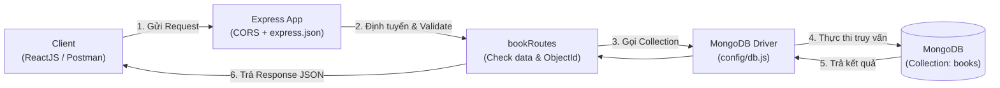

# Library CRUD API (Express.js & MongoDB)

Bài tập ngày 27/08/2026 - Tích hợp MongoDB với Express xây dựng CRUD API quản lý sách.

---

## Luồng Dữ Liệu (Data Flow)

### 1. Sơ đồ tổng quan



### 2. Các bước xử lý chi tiết:

1. **Client gửi Request:** Gửi HTTP request (`GET`, `POST`, `PUT`, `DELETE`) kèm params hoặc body JSON tới `http://localhost:3000`.
2. **Middleware:**
   - `CORS`: Cho phép Frontend (ReactJS) gọi API.
   - `express.json()`: Parse dữ liệu gửi lên thành `req.body`.
3. **Router & Validation (`routes/bookRoutes.js`):**
   - Kiểm tra các trường bắt buộc (`title`, `author`).
   - Kiểm tra định dạng và ép kiểu `id` từ `string` sang `new ObjectId(id)`.
   - Lọc các trường an toàn khi update (whitelist: `title`, `author`, `category`, `available`).
4. **Database Driver (`config/db.js`):** Gọi các hàm MongoDB tương ứng (`insertOne`, `find`, `findOne`, `updateOne`, `deleteOne`).
5. **MongoDB Server:** Thực hiện đọc / ghi dữ liệu trên collection `books`.
6. **Phản hồi (Response):** Express trả về mã trạng thái (`200`, `201`, `400`, `404`, `500`) và dữ liệu JSON về cho Client.

---

## Danh Sách API Endpoints

| Method | Endpoint | Mục đích | Status Code |
| :--- | :--- | :--- | :--- |
| `GET` | `/` | Kiểm tra server | `200` |
| `POST` | `/books` | Thêm sách mới | `201` / `400` / `500` |
| `GET` | `/books` | Lấy danh sách tất cả sách | `200` / `500` |
| `GET` | `/books/:id` | Lấy chi tiết sách theo ID | `200` / `400` / `404` / `500` |
| `GET` | `/books/category/:category` | Tìm sách theo thể loại | `200` / `500` |
| `PUT` | `/books/:id` | Cập nhật thông tin sách | `200` / `400` / `404` / `500` |
| `DELETE` | `/books/:id` | Xóa một cuốn sách | `200` / `400` / `404` / `500` |

---

## Cài Đặt & Khởi Chạy

```bash
# 1. Cài đặt dependencies
npm install

# 2. Tạo file .env từ .env.example
PORT=3000
MONGODB_URI=your_mongodb_connection_string
DATABASE_NAME=aptech_library

# 3. Chạy server
npm start        # Chế độ thường
npm run dev      # Chế độ dev (tự reload)

# 4. Chạy script test toàn bộ API
npm run test:api
```

---

## Chuẩn Bị Tích Hợp Frontend ReactJS

- **Cổng kết nối:** Backend chạy cổng `3000`, ReactJS chạy cổng `5173`.
- **Cấu trúc dữ liệu JSON của 1 cuốn sách:**
```json
{
  "_id": "66b1f0b8e3c9a7d1a1234567",
  "title": "Node.js Basics",
  "author": "Aptech",
  "category": "Programming",
  "available": true
}
```
- **Các màn hình frontend dự kiến:**
  - `BookList`: Hiển thị danh sách sách, trạng thái mượn và nút Sửa / Xóa.
  - `BookForm`: Form thêm mới và chỉnh sửa thông tin sách.
  - `CategoryFilter`: Lọc sách theo chuyên mục.
